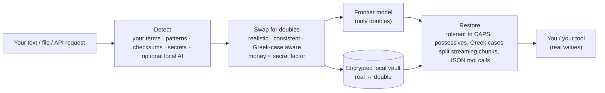

<div align="center">

# Doublecast

**Keep your data home. Send its double to the AI.**

Doublecast swaps your company's sensitive values (customers, suppliers, people, sites, IDs, IBANs, prices, secrets) for realistic stand-ins *before* anything leaves your machine, then puts the real values back into the answer.
It works with **Claude Code, Codex, claude.ai, ChatGPT, Gemini, any OpenAI- or Anthropic-compatible tool, and your Excel, Word, CSV and PDF files.**

[](https://github.com/mimisbadawy78/doublecast/actions/workflows/ci.yml)
[](LICENSE)


</div>

<!-- Record the demo with `vhs demo/demo.tape` and commit docs/demo.gif -->
<!--  -->

```text
 What you write                         What the AI sees                         What you get back
 ─────────────────────────────────────  ───────────────────────────────────────  ─────────────────────────────────
 Nordia Hellas wants 8% off invoice       Verfield Hellas wants 8% off invoice     Nordia Hellas should get 6%, not 8%:
 INV-2024/0187. Eleni Papadopoulou      INV-0100/4600. Anna Tzannis says the     at €1.234.567,89 a year the
 says the account is €1.234.567,89.     account is €2.928.162,94.                margin can't absorb more.
```

The AI never sees *Nordia*, *Eleni Papadopoulou*, the invoice number or the real revenue, yet its reasoning holds: the money was scaled by a secret factor, so every ratio and margin is still correct.

---

## Why

Most companies want frontier AI on their real work: customer P&Ls, supplier contracts, payroll, tenders, code. Most can't send that data to a third party. The usual answer, "redact it", breaks the AI's reasoning (`[REDACTED] wants [REDACTED] off [REDACTED]`) and leaves you to stitch the answer back together by hand.

Doublecast takes a different approach: **consistent, realistic doubles that round-trip**.

| | Typical PII redactors | Doublecast |
|---|---|---|
| Built around | People's names and emails | **Business data**: customers, suppliers, SKUs, plants, deals, prices, plus personal data |
| What you set up | Lists, or an AI model | **Nothing**: names are found from the structure of emails and spreadsheets and remembered; or learned from your own systems (Power BI, Microsoft 365, Dynamics 365, SharePoint, SQL) |
| What the AI sees | `[PERSON_1]`, `<ORG>` | Realistic doubles: "Verfield Hellas", "Anna Tzannis" |
| Numbers | Left alone (leak) or masked (useless) | **Secret scaling**: real amounts hidden, every ratio exact |
| Answer comes back | With placeholders you decode by hand | **Restored automatically**, even when streamed token by token |
| Languages | English first | **Greek, English, German, French, Italian, Spanish**, including Greek grammatical cases |
| Works in | One SDK or one app | **Proxy** (Claude Code, Codex, any API tool), **files**, **clipboard** (web chats), **MCP** |

## Install

```bash
pip install "doublecast[all] @ git+https://github.com/mimisbadawy78/doublecast"   # Python 3.10+
doublecast init                     # creates ~/.doublecast/{config.yaml, key, vault}
```

That's it: no lists required. Doublecast protects names three ways, from least to most effort:

1. **Auto mode (on by default).** Names are found from the structure of business text: email
   headers, greetings ("Dear Petros", «Αγαπητέ κ. Ανδρέου»), titles, sign-offs, company legal
   forms ("… S.A.", "… ΑΕ", "… GmbH"), spreadsheet columns headed Customer / Πελάτης / Salesperson
   / Είδος, and capitalised names mid-sentence. Every name found is **remembered**, so it is
   caught everywhere afterwards, in any case or Greek inflection.
2. **Discovery.** Point Doublecast at your systems once and it learns every customer, supplier,
   product, employee and site they contain, refreshed nightly:
   ```bash
   doublecast discover path ~/Documents/masterdata   # a folder of Excel/CSV files, no setup
   doublecast discover                               # Power BI, Microsoft 365, Dynamics 365, SharePoint, SQL
   ```
   It classifies every column by its name and a sample of its values, in six languages, and
   never sends anything anywhere. See [docs/discover.md](docs/discover.md).
3. **Your own list** for the handful of values that must always be protected:
   ```yaml
   terms:
     ORG:     [Nordia Hellas, {value: Kallergis, aliases: [Καλλέργης]}]
     PROJECT: [Project Falcon]
   allow:   [Greece, Athens]         # never touch these
   ```

Patterns catch everything with a recognisable shape, with no lists needed: emails, phones, IBANs (checksum-validated), Greek ΑΦΜ / ΑΜΚΑ / ΑΔΤ, EU VAT numbers, Spanish DNI/NIE, Italian codice fiscale, French NIR, German Steuer-ID, invoice/PO/lot/SKU/case/patient numbers, IPv4 addresses, money (including `€2.3m`, `$1.2bn`, `1,5 εκατ. ευρώ`), and API keys, tokens, passwords, `Bearer`/`Basic` credentials and card numbers (removed, never restored). Column headers count as context in spreadsheets, so a bare number under "ΑΦΜ" is treated as a VAT number.

## Use it everywhere

### Claude Code

```bash
doublecast run -- claude            # one protected session, nothing to configure
```

Or keep it running and point Claude Code at it, which works with your normal Claude login:

```bash
doublecast proxy                    # terminal 1
export ANTHROPIC_BASE_URL=http://127.0.0.1:8787    # or put it in ~/.claude/settings.json → "env"
claude                              # terminal 2
```

### Codex

```bash
doublecast proxy
doublecast env codex                # prints the two lines for ~/.codex/config.toml
```

API-key users set `openai_base_url`; ChatGPT-login users get a custom provider pointing at the proxy's `/backend-api/codex` route. Details in [docs/codex.md](docs/codex.md).

### claude.ai, ChatGPT, Gemini (web)

```bash
doublecast clip scramble    # copy your text, run this, paste into the chat
doublecast clip restore     # copy the answer, run this, paste wherever you need it
```

### Files

```bash
doublecast scan  Q3-customer-review.xlsx      # see what would change; changes nothing
doublecast scramble Q3-customer-review.xlsx   # -> Q3-customer-review.doublecast.xlsx  (upload this)
doublecast restore  answer.docx               # -> answer.restored.docx
```

Excel keeps formulas and formats (money columns are scaled, percentages untouched); Word keeps run-level formatting, tables, headers and footers; PDFs are extracted to Markdown.

### As a Claude skill

Add [`integrations/claude-skill/doublecast`](integrations/claude-skill/doublecast/SKILL.md) to Claude
(`~/.claude/skills/` for Claude Code) and Claude will read company files through Doublecast and
write results back with real values restored, without being reminded. See [docs/skill.md](docs/skill.md).

### Agents (MCP)

```bash
claude mcp add doublecast -- doublecast mcp
codex  mcp add doublecast -- doublecast mcp
```

The agent gets `read_scrambled`, `write_restored`, `make_scrambled_copy`, `restore_file_copy` and `vault_stats`. **No tool ever returns a real value to the model**, so there is deliberately no `restore_text`.

## How it works



- **Doubles are deterministic per vault.** The same customer always gets the same double, across messages, files and days. That keeps the AI's understanding consistent and keeps provider prompt-caching working.
- **The vault** (`~/.doublecast/<workspace>.vault`) stores real values encrypted (Fernet: AES + HMAC) and looks them up by keyed hash. The key never leaves `~/.doublecast/key` (permissions 600). One vault per workspace: keep clients apart.
- **Secret money scaling.** Every amount in a workspace is multiplied by one hidden factor *k* > 1. Ratios, margins, shares and growth rates stay exact; absolute figures don't leak. Because *k* > 1, rounding then dividing back always returns the original amount exactly.
- **Streaming-safe.** The proxy restores Anthropic and OpenAI (Chat Completions and Responses) event streams, holding back only the few characters that could still be part of a double or an amount split across chunks. Tool-call arguments are restored inside their JSON with correct escaping.
- **Case follows the text.** If the model writes a double in capitals, the real value comes back in capitals too.
- **Signed reasoning is left alone.** Thinking/reasoning blocks pass through byte-for-byte in both directions, so provider signatures stay valid, and they only ever contain doubles.
- **Failure policy is yours.** `mode: warn` logs and still sends; `mode: block` refuses to send, including any request body that isn't JSON. Secrets are stripped in both modes.
- **One exception, for Claude Code only.** Claude Code's first system block (its attribution block, checked by Anthropic for subscription logins) is forwarded unchanged when the request comes from Claude Code. Every other client's system prompt is scrambled. Turn this off with `proxy.pin_claude_code_system: false`.

## Greek, properly

Greek nouns change form with grammatical case, and English-first tools miss it. Doublecast matches **Καλλέργης / Καλλέργη / ΚΑΛΛΕΡΓΗΣ / καλλεργης** as the same customer. It gives Greek names doubles from the same declension class, word by word, so «του Γιώργου Καλλέργη» becomes «του Χρήστου Μπακάλη» and comes back as «του Γιώργου Καλλέργη», with the grammatical case kept in both directions. (When an inflection moves the accent, as in Τρόφιμα → Τροφίμων, the restored word can carry the accent of its base form.) It also validates ΑΦΜ and ΑΜΚΑ checksums, recognises Greek IBANs, mobile numbers, ΑΔΤ, ΕΦΚΑ ΑΜΑ, τιμολόγια, παραγγελίες, δελτία αποστολής, and Greek plates.

## Benchmark

`doublecast bench` generates a synthetic multilingual corpus (Greek, English, German, French, Italian, Spanish) and measures leaks and round-trips. Latest run, 1,800 documents ([full report](docs/benchmark.md)):

| Measure | Result |
|---|---|
| Listed or pattern-detectable values leaked (companies, people, sites, emails, phones, IBANs, tax and national IDs, invoice numbers, secrets) | **0 of 5,866** |
| Exact round-trip `restore(scramble(x)) == x` | **100%** |
| Restore after the model upper-cases, adds possessives, or puts a Greek name in the genitive | **100%** |
| Ratio drift from money scaling | < 0.001% |
| **Names nobody listed**, in that same corpus (caught by auto mode alone) | **0 of 543** |

**Auto mode with no lists at all** (`doublecast bench --auto`, 600 synthetic emails, every name new, [report](docs/benchmark-auto.md)):

| Where the name appears | Leaked |
|---|---|
| Email headers, greetings, titles, sign-offs, company legal forms | **0%** |
| Seen once anywhere, mentioned again later with no structure | **0%** |
| New name mid-sentence | **0%** |
| New name at a sentence start, common first name | **0%** |
| New name at a sentence start, **uncommon first name** | **100%**: the gap that discovery or a list closes |
| Ordinary capitalised phrases swapped by mistake | 1 of 10 ("Purchase Requisition") |

The vocabulary threshold was tuned while looking at those 10 phrases, so treat that row as indicative. Real-world over-protection reports are welcome.

**Read this honestly.** The corpus is synthetic and written by the same project that it tests, so a 0% here is a regression gate, not a guarantee. Harder, adversarial test cases are the most valuable contribution you can make.

## What Doublecast does *not* do

- **It is not anonymisation.** Context can still identify a company ("the largest olive-oil exporter on Crete"). A [2026 study](https://www.alphaxiv.org/abs/2605.30848) found web-search agents re-identified roughly half to three-quarters of Presidio-redacted transcripts from context alone. Doublecast reduces exposure; it does not make you anonymous.
- **Not every unknown name is caught.** Auto mode needs a clue: structure, a capital letter mid-sentence, or a common first name. A name seen for the first time at the start of a sentence with an uncommon first name, or written in lower case, passes through. Discovery covers every name in your systems; the optional local AI detector (`pip install "doublecast[ner]"`) adds a safety net. `doublecast scan` shows exactly what will change.
- **Auto mode over-protects a little.** A capitalised phrase that isn't everyday vocabulary may be swapped even when it isn't a name (an internal product line, a team nickname). That is harmless for privacy; turn it off with `auto.capitalized_phrases: false`.
- **Doubles can be swapped twice.** If text that already contains doubles is scrambled again (for example a scrambled file read through the proxy), names may be doubled again. Restoring then returns the first double, not the real name. Emails, IBANs and IDs are never doubled twice.
- **Only what you listed, in the forms you listed.** `Nordia Hellas` is caught in any case, accent or Greek inflection, but `Nordia-Hellas`, `NordiaHellas`, the bare brand `Nordia`, or `Larissa` on its own (when you listed `Larissa Plant`) are not. Add those as aliases or separate terms.
- **Images and binary PDFs inside API requests** can't be rewritten; the proxy logs a warning when they pass through. Scramble files with `doublecast scramble` first.
- **Amounts the AI invents** from general knowledge ("a typical €100 fee") are divided by the secret factor on the way back too. Amounts the AI computes from your figures restore to within a cent.
- **Recipes, formulas and other know-how expressed as ratios** stay visible by design: the model needs them to help. Use a local model for those.
- **Claude Code still sends some traffic directly to Anthropic** (telemetry, update checks, a fast-mode check, the WebFetch domain check), outside any proxy. Set `CLAUDE_CODE_DISABLE_NONESSENTIAL_TRAFFIC=1` to switch the non-essential part off. See [docs/security.md](docs/security.md).

## Configuration

Everything lives in `~/.doublecast/config.yaml` (override the folder with `DOUBLECAST_HOME`). Key options:

| Option | Default | What it does |
|---|---|---|
| `workspace` | `default` | Separate vault and secret factors per client/company/project (`-w` on the CLI) |
| `mode` | `warn` | `warn`: log and send · `block`: refuse to send when scrambling fails |
| `packs` | all | `fmcg`, `finance`, `hr`, `legal_health` pattern packs |
| `languages` | all six | Which national ID / phone patterns to run |
| `auto.structure` / `auto.capitalized_phrases` / `auto.learn` | `true` | Auto mode: find names without lists, broad net, remember what is found |
| `discover.sources` | none | Systems to learn from ([docs/discover.md](docs/discover.md)) |
| `numbers.scale_money` | `true` | Secret scaling for amounts with a currency |
| `numbers.scale_quantities` | `false` | Same for kg, units, cases, pallets (separate factor) |
| `dates.shift` | `false` | Move dates by a secret number of whole weeks (weekdays stay right; each date keeps its written form) |
| `ner.enabled` | `auto` | Use the local AI detector if installed |

Full reference: [docs/configuration.md](docs/configuration.md). Industry packs: [docs/packs.md](docs/packs.md).

## Commands

| Command | |
|---|---|
| `doublecast init` | Create config, key and vault |
| `doublecast scan FILE` | Show what would be swapped (changes nothing) |
| `doublecast scramble FILE` / `restore FILE` | Files, or `-` for stdin → stdout |
| `doublecast clip scramble` / `clip restore` | Clipboard, for web chats |
| `doublecast proxy` | Local proxy for API tools |
| `doublecast run -- <command>` | Run one command through a temporary proxy |
| `doublecast env claude\|codex` | Print the settings for a tool |
| `doublecast mcp` | MCP server (stdio) |
| `doublecast vault stats\|list\|forget\|wipe` | Manage the vault |
| `doublecast discover [path FOLDER]` | Learn what is sensitive from your systems ([docs](docs/discover.md)) |
| `doublecast discover status\|ignore\|forget` | See and manage discovered and learned rules |
| `doublecast bench [--auto]` | Leak benchmark (with lists, or auto mode with none) |
| `doublecast doctor` | Check the installation |

## Roadmap

- Browser extension for claude.ai, ChatGPT and Gemini (scramble on paste, restore in-page)
- Desktop drag-and-drop app for non-technical colleagues
- PowerPoint support, OCR for scanned PDFs
- Discovery connectors for Salesforce, SAP, Google Workspace and HubSpot
- Benchmarked local NER for Greek, and more languages (Bulgarian, Romanian, Turkish, Arabic)
- Shared team vaults, and an audit log of what was protected

## Contributing

Issues and pull requests are welcome, especially **hard test cases** (real-world text shapes that leak), **new country patterns** with checksum validators, and **industry packs**. See [CONTRIBUTING.md](CONTRIBUTING.md). Found a leak that matters? See [SECURITY.md](SECURITY.md).

## License

[Apache-2.0](LICENSE) © 2026 Mimis Badawy
