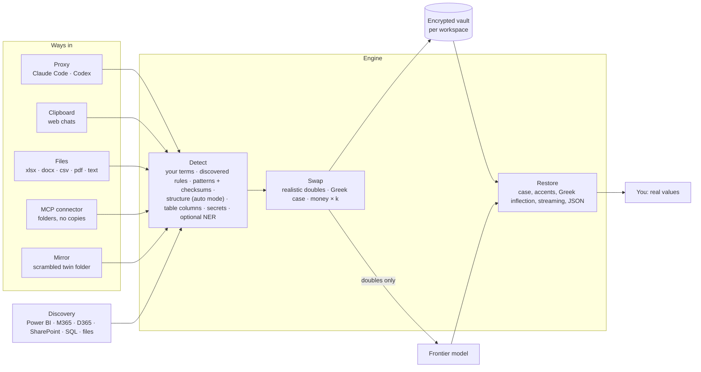

# How Doublecast was built

A record of what was built, in what order, what it measured, and what went wrong on the way.
Written 28 October 2026 at version 0.2.6. Built by Mimis Badawy with Claude (Anthropic); the
code, tests and benchmarks are in this repository.

## In one paragraph

Doublecast lets you use frontier AI models on sensitive business data. Before anything leaves
your computer it swaps real names, companies, contacts, IDs and amounts for realistic, consistent
**doubles**, keeps the mapping in an encrypted local vault, and puts the real values back in what
comes back. Money is multiplied by one secret factor, so margins, shares and growth rates stay
true while the amounts don't leak. It works with Claude Code and Codex (a local proxy), web chats
(the clipboard), files (Excel, Word, CSV, PDF, text), the Claude app and other agents (an MCP
connector that opens folders scrambled, with no copies), and it learns what is sensitive from the
systems a company already has (Power BI, Microsoft 365, Dynamics 365, SharePoint, SQL).

## Timeline

| Date (2026) | Version | What shipped |
|---|---|---|
| 15 Oct | 0.1.0 | Engine (dictionary, patterns with checksums, secrets, optional local NER), deterministic doubles with Greek declension, secret money scaling with exact restore, encrypted per-workspace vault, proxy for Claude Code and Codex (streaming-safe), files, clipboard, MCP server, leak benchmark. Hardened after an independent adversarial review. |
| 15 Oct | 0.2.0 | **Auto mode** (no lists: structure of business text in six languages, strict learning), column understanding in spreadsheets, **discovery** from Excel/CSV folders, SQL, Microsoft 365, Power BI, Dynamics 365 F&O, Dataverse, Business Central; Claude skill; auto-mode benchmark. Second independent review. |
| 21 Oct | 0.2.1 | Doubles that read like real people and companies: real name pools by language and gender, Greek feminine surnames, one double across Greek and Latin script, emails built from the person's and company's doubles. |
| 21 Oct | 0.2.2 | **Blind benchmark** (130 documents written by an agent that never saw the code) against Microsoft Presidio, and the fixes it found: leaks 40% → 16%, exact restore 116/130 → 130/130. Tables, chat speakers, initials, surname-first lists, phones and tax IDs in six countries, addresses. |
| 21 Oct | 0.2.3 | Status everywhere: `doublecast status`, a menu-bar / tray icon (counts, last swaps masked, clipboard buttons, start at login), a Claude Code status line and `/doublecast` pane. |
| 21 Oct | 0.2.4 | Mirror folders: a scrambled twin of a folder for AI tools with folder access. Names matched inside identifiers and file names. |
| 24 Oct | 0.2.5 | **Folders through Doublecast, no copies** (`list_folder`, `search_folder`, `read_file`, `save_file`, locked to allowed places). Spreadsheet models that still add up after scrambling. Mirror safety after an incident (below). |
| 24 Oct | — | CI green again (benchmark scripts failed the lint step since 0.2.2), actions on Node 24; smaller read pages for chat apps. |
| 25 Oct | 0.2.6 | Fixes found on a real Dynamics 365 export: alias, contact and website columns; websites in text; names learned before scrambling; a series of exact-restore fixes. |

## Architecture

| Layer | Modules | What it does |
|---|---|---|
| Detection | `detectors/` (dictionary, patterns, heuristics, tables, secrets, ner) | Finds what is sensitive: listed and learned terms in any case, accent or Greek inflection; checksummed IDs (IBAN, ΑΦΜ, AMKA, DNI, EAN, cards); phones, emails, web addresses; names from the structure of business text; spreadsheet and Markdown/CSV tables by their headers. |
| Doubles | `surrogates.py`, `data/realnames.py` | Deterministic per vault: same person, same double everywhere. Real name pools by language and gender, Greek declension classes, emails and websites built to match. |
| Numbers | `numbers.py`, `files/tabular.py` | One secret factor *k* > 1 for money (optionally quantities and dates); exact restore by construction. In spreadsheets, column headers and row labels decide what is money and what never is (switches, indices, %, days, units, counts). |
| Vault | `vault.py` | Real values encrypted (Fernet), looked up by keyed hash; the key stays in `~/.doublecast/key`. |
| Restore | `restore.py` | Trie index over doubles; tolerant to capitals, possessives, accents, Greek cases, text split across stream chunks, and JSON tool calls. |
| Ways in | `proxy/`, `cli.py` (clip, scramble, restore), `files/`, `mcp_server.py` + `gateway.py`, `mirror.py` | The surfaces above. |
| Discovery | `discover/` | Reads names and column profiles from company systems, read-only, and stores encrypted rules. |
| Status | `activity.py`, `tray.py`, `integrations/claude-code/` | Counts and masked samples only; menu-bar icon, Claude Code status line. |

About 11,000 lines of Python, 245 tests, CI on Linux, macOS and Windows with Python 3.10–3.13,
plus a leak gate that fails the build if any listed value leaks.

## The numbers

**With lists or discovery** (`doublecast bench`, synthetic, six languages): 0 leaks across 6,409
values (emails, IBANs, IDs, national IDs, companies, people, phones, secrets, sites, tax IDs);
exact restore 1,653/1,653; restore after the model changes case, adds possessives or Greek
genitive 3,316/3,316.

**Auto mode, no lists** (`doublecast bench --auto`): 0% leaked for names in email headers,
greetings, titles, legal forms, names seen before, mid-sentence names and common first names at a
sentence start; 2.5% for uncommon first names at a sentence start (the known gap).

**Blind benchmark** ([benchmark-blind.md](benchmark-blind.md)): 130 documents, 1,542 sensitive
values, 686 ordinary phrases that must stay, written by an agent that never saw the code.

| | Doublecast | Microsoft Presidio (default) |
|---|---:|---:|
| Values leaked (amounts and internal codes aside) | **16%** | 28% |
| Emails / IBANs / phones leaked | **0% / 0% / 0%** | 0% / 50% / 12% |
| Ordinary phrases changed by mistake | **2.8%** | 45% |
| Documents restored exactly | **130 / 130** | n/a (one-way) |
| With a master-data export (discovery) | **0 of 94** names leaked | — |

**Real files** (25 Oct, a company's Dynamics 365 export and BI extracts, measured as counts only):
customer, vendor and setup files restore cell-for-cell; 2–9 names per file remain visible, all made
only of generic words ("Wholesale Foods"). The items file still has 25 cells that do not restore
exactly (see open items).

**Other measurements:** proxy adds about 1.6 s to the first request of a long Claude Code session
(110 KB) and about 0.2 s per turn after; Power BI discovery lists 1,137 columns of a real tenant
through `INFO.VIEW.COLUMNS()`; `pip-audit` and `bandit` clean.

## What went wrong, and what changed because of it

1. **"Connected" is not "protected" (21 Oct).** A chat in the Claude app opened a real costing file
   with its own tools, and the file had also been attached. Doublecast was installed but never in
   the path. *Changed:* the README says plainly that attachments and cloud connectors bypass
   Doublecast; the recommended way in became the connector that is the only door to a folder.
2. **Two mirrors on one twin (21 Oct).** A twin folder was rebuilt with a new vault while the
   owner's mirror was running. Each copied the other's files back as "the AI's work": 131 junk
   files and 17 overwritten originals in a real folder (11 recovered from a download, 6 to
   redo). *Changed:* one owner per twin (a second one is refused), a backup before any real file
   is replaced, more than 20 AI changes at once held until accepted, leftovers of an interrupted
   first run never copied back.
3. **Scrambled models stopped adding up, and showed the factor (21 Oct).** Scaling every number
   under a "Value" header scaled a scenario switch from 1 to *k*, which both broke the model and
   revealed *k*. *Changed:* row labels decide (switches, indices, %, days, units, counts are never
   scaled; a 1 is never scaled); formula results are recalculated (LibreOffice); mirrored models
   are checked cell by cell against the original.
4. **Names next to the name column (25 Oct).** In a real ERP export the company-name column was
   scrambled but the short-name, contact and website columns were not, and a model named
   customers from them. *Changed:* those columns, websites in text, learning every name in a
   table before scrambling (and a bug that silently never saved spreadsheet-learned names).
5. **CI red for three days (21–24 Oct)** because benchmark scripts failed the lint step. Fixed.

## Open items

- A real code equal to a double made for another file can still restore into the wrong code in
  rare cases (25 cells in one test file); two spellings that differ only in spacing or quotes
  share one double.
- Discovery run on a folder of financial models misreads P&L rows as projects and amounts as
  phone numbers; use it on master-data exports.
- Excel models need LibreOffice for formula results to be visible to the AI.
- The macOS menu-bar icon has not yet been confirmed on a real Mac.
- Uncommon first names at the start of a sentence remain the main auto-mode gap.

## Using it today

| Where you work | How |
|---|---|
| Claude Code, Codex | `doublecast run -- claude` (or the proxy): everything that leaves is scrambled |
| Claude app, any MCP agent | `doublecast allow ~/Downloads` once; don't add folders to the chat, name them: *"Use Doublecast on <folder>"* |
| Web chats | Scramble clipboard, paste, copy the answer, Restore clipboard |
| Files to share or upload | `doublecast scramble file.xlsx`, then `doublecast restore` on what comes back |
